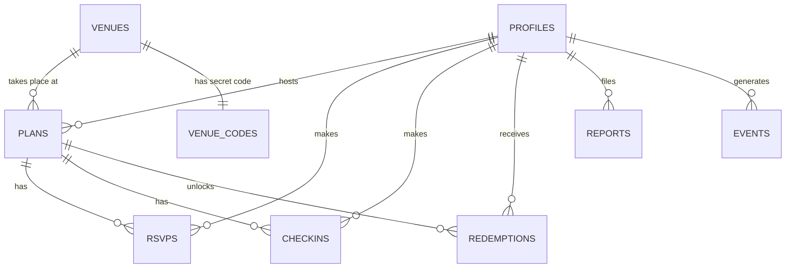

# Data model

All tables live in Supabase Postgres (`public` schema). Row Level Security is on for every table.
Source of truth: `supabase/migrations/001_schema.sql`.

| Table | Key fields | Notes |
|-------|-----------|-------|
| **profiles** (User) | id (= auth user id), display_name, is_admin, is_test_account, seed_key, confirmed_18 | Created by a trigger at sign-up. Users can only change `display_name`. |
| **venues** (Venue) | slug, name, category, neighborhood, offer, discount_pct, quiet_hours, emoji, color, is_fictional, lat, lng | Public read. 10 fictional Copenhagen venues. |
| **venue_codes** | venue_id, code | Secret 4-char check-in codes. No client access; admins read them via `get_venue_codes()`. |
| **plans** (Plan) | venue_id, host_id, title, note, starts_at, max_size (2–8), status (open/cancelled) | Insert validated by trigger (future time, ≤14 days ahead, ≤3 upcoming per host). |
| **rsvps** (RSVP) | plan_id, user_id, created_at | Written only by `join_plan` / `leave_plan`. Host is added automatically. |
| **checkins** (Check-in) | plan_id, user_id, created_at | Written only by `check_in`. |
| **redemptions** (Redemption) | plan_id, user_id, venue_id, discount_pct, code, local_date | Created by `check_in` when 2+ have checked in. Unique per user + venue + day. |
| **reports** | reporter_id, plan_id, reported_user_id, reason, details, status | Report button. Users see their own; admin sees all. |
| **events** | user_id, session_id, name, plan_id, venue_id, meta, created_at | Test log. Users can insert their own; only admins can read. |

## Functions (RPC)

| Function | Who | What it does |
|----------|-----|-------------|
| `join_plan(p_plan)` | signed-in | Locks the plan row, checks open / not ended / not full, adds RSVP, logs `plan_joined` |
| `leave_plan(p_plan)` | signed-in | Not for hosts or after check-in. Logs `plan_left` |
| `cancel_plan(p_plan)` | host or admin | Sets status `cancelled`, logs `plan_cancelled` |
| `check_in(p_plan, p_code)` | signed-in | Validates code + window + RSVP, adds check-in, unlocks discounts at 2+, returns JSON |
| `get_venue_codes()` | admin | Lists codes for the facilitator |
| `reset_demo_data(p_clear_events)` | admin | Deletes plans etc., optionally the event log, re-creates sample plans |
| `seed_demo_plans()` | internal | 10 sample plans relative to "now", hosted by fictional seed users |

## Event names logged

`session_start`, `view_venue`, `view_plan`, `view_map`, `map_select_venue`, `map_area`, `open_new_plan`, `plan_posted`*, `plan_joined`*,
`plan_left`*, `plan_cancelled`*, `checkin_failed`*, `checked_in`*, `discount_unlocked`*,
`report_filed`, `sign_out`, `data_reset`*  (* = logged by the database, cannot be skipped)
